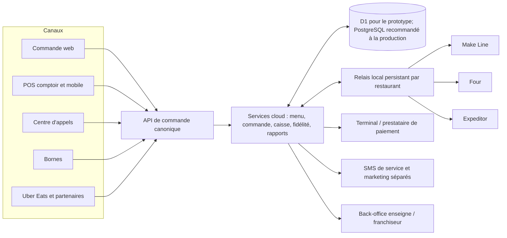

# Architecture POS / KDS Dolce Pizz’

## Pourquoi cette architecture

La démo actuelle est un site de commande en ligne pour Dolce Pizz’ à Ronchin, construit avec Next/vinext, React, Cloudflare Workers, D1/SQLite et Drizzle. Elle sait gérer une carte, les commandes web à emporter, le paiement au comptoir, la fidélité, les SMS promotionnels avec consentement, un espace équipe et un écran cuisine.

Elle n’est pas encore un POS/KDS de production multi-sites. Le schéma contient un tenant Dolce Pizz’ et les fiches de Ronchin et Tourcoing, mais seul Ronchin est configuré et la plupart des données et permissions ne sont pas encore isolées par tenant. Il n’y a pas encore de caisse certifiée, de paiement par terminal, de bornes, de centre d’appels, de connecteur Uber Eats ni de fonctionnement local hors ligne. Un modèle métier pur décrit les étapes Make Line/Four/Expeditor, mais il n’est pas encore relié aux écrans ni à la base. Les sections ci-dessous distinguent la cible du produit des fonctions réellement installées.

## Cible technique

Le produit se découpe en cinq couches. Cette séparation permet de vendre les mêmes fonctions aux établissements indépendants et aux réseaux, tout en configurant leurs postes et leurs règles sans créer une application différente pour chaque restaurant.

| Couche | Responsabilité | Exemples |
|---|---|---|
| Présentation | Écrans adaptés au rôle, à l’appareil et à l’établissement | site client, borne, POS comptoir/mobile, centre d’appels, Make Line, Four, Expeditor, back-office |
| Communication | Transport des commandes et notifications | API HTTPS, événements temps réel, WebSocket/SSE, file persistante, webhooks signés, SMS |
| Métier | Règles communes à tous les canaux | prix, créneaux, routage, préparation, paiement, fidélité, annulation, promotions |
| Données | Stockage et traçabilité | tenants, sites, menu versionné, commandes, tâches, paiements, shifts, événements, journaux d’audit |
| Intégrations | Traduction avec les systèmes externes | Uber Eats, prestataire de SMS, terminal de paiement, imprimantes, comptabilité et livraison |

Les intégrations sont derrière des adaptateurs : un changement de fournisseur SMS ou de partenaire de livraison ne doit pas réécrire le cycle de commande.



Le site utilise aujourd’hui D1/SQLite. Pour le produit SaaS commercial, je recommande un cœur de données PostgreSQL avec transactions cohérentes, index tenant/site et possibilité de politiques de ligne. Le choix hébergeur reste ouvert; les écrans et adaptateurs ne doivent pas dépendre directement du fournisseur de base.

**Règle de conception :** tous les canaux créent le même type de commande. Ils ne développent pas chacun leur propre logique de prix, de disponibilité, de fidélité ou de production.

## Organisation des données

```text
Compte SaaS
└── Tenant / organisation (ex. Dolce Pizz’)
    ├── Membres, permissions et appareils
    ├── Menu de référence et versions publiées
    └── Établissements
        ├── Ronchin
        └── Tourcoing (adresse et zone à confirmer)
```

Chaque donnée opérationnelle doit porter le tenant et, lorsqu’elle est locale, l’établissement. Les droits sont vérifiés côté serveur à chaque lecture et écriture. Cacher un bouton dans l’interface n’est jamais une règle d’autorisation.

La première migration ajoute les organisations, les établissements, les memberships, les appareils et le scope des commandes au dépôt. Ce sont des fondations de données, pas encore une isolation multi-tenant complète : la plupart des routes existantes ne filtrent pas encore toutes leurs requêtes par organisation/site et l’authentification du personnel reste à créer. D1/SQLite n’applique pas de politiques RLS; le serveur doit imposer le scope dans les requêtes et une suite de tests doit tenter les accès croisés entre tenants.

Le menu de l’enseigne est versionné. Un site peut appliquer des prix ou des disponibilités autorisés localement. Une commande conserve un instantané du nom, des prix, des options, des ingrédients, des allergènes et des taxes au moment de sa création : une nouvelle version du menu ne modifie pas une vente passée.

Entités principales : `tenants`, `locations`, `memberships`, `devices`, `menu_versions`, `products`, `orders`, `order_items`, `production_tasks`, `payments`, `cash_shifts`, `integrations` et `audit_events`.

## Parcours d’une commande

```text
Canal → choix/validation de l’établissement → commande acceptée
      → routage des articles → Make Line → Four si nécessaire
      → autres postes (boissons, desserts) → Expeditor
      → commande prête → alerte de service → remise
      → encaissement au retrait pour les commandes directes
```

Les trois états doivent rester distincts :

- **Commande** : reçue, acceptée, prête, remise, annulée.
- **Production par article** : à préparer, assemblé, en cuisson, cuit, contrôlé.
- **Paiement** : à encaisser au retrait, encaissé, remboursé ou en échec.

Le Make Line indique « assemblé, prêt à enfourner ». Le poste Four confirme le chargement et démarre le minuteur. L’Expeditor vérifie tous les articles avant de marquer la commande prête. Une annulation ou correction est un événement audité; une commande envoyée en cuisine n’est pas effacée.

Le dépôt contient maintenant un premier automate métier pur dans `lib/production-flow.ts`, testé indépendamment : une pizza passe par Make Line, Four et Expeditor; les boissons passent directement à Expeditor; toute unité doit finir toutes ses étapes avant que la commande soit déclarée prête. Les transitions hors séquence sont rejetées, les commandes portent une révision pour détecter les actions concurrentes, et rouvrir une annulation exige une confirmation superviseur ainsi qu’une remise à zéro. Ce code de domaine n’est pas encore connecté à la base, aux écrans KDS ou à une véritable identité superviseur; il sert de fondation testée, pas de poste de production déployable.

Les commandes web, téléphone, comptoir, bornes, Uber Eats et livraison maison utilisent cette même chaîne. La différence entre les canaux reste enregistrée : une commande Uber Eats suit les règles de paiement et de règlement de la plateforme; une commande directe peut être encaissée au retrait.

### Responsabilités des postes

| Poste | Ce qu’il voit | Ce qu’il peut valider |
|---|---|---|
| Make Line | Articles à assembler, recette, taille, suppléments, retraits et allergènes | Assemblé / prêt à enfourner; signaler une rupture ou un blocage |
| Four | Articles à cuire, ordre, durée et heure cible | Enfourné, minuterie démarrée, sorti du four |
| Expeditor | Vue regroupée de toute la commande et avancement de chaque poste | Vérifier la complétude, marquer « prête », gérer l’attente et la remise |
| POS comptoir/mobile | Vente, commandes du site, encaissements et demandes de service autorisées | Créer une commande, encaisser, remettre, annuler selon permission |
| Centre d’appels | Commande, téléphone, adresse, disponibilité des sites | Choisir le site selon l’adresse pour livraison; proposer le retrait au client pour emporter |
| Borne | Menu publié, options et progression de la commande | Créer la commande; montrer clairement que le paiement se fait au retrait dans la règle actuelle |

Les tâches sont générées depuis les lignes de commande et les règles de routage du menu; les écrans ne sont pas des rôles d’autorisation. Un employé nominatif reçoit les permissions, alors qu’un appareil enrôlé reçoit un poste et un établissement. Ainsi, remplacer une tablette ne nécessite pas de partager un compte administrateur.

Cette séparation reprend une pratique éprouvée des KDS de restauration : affecter les articles et modificateurs aux postes de préparation, puis donner à l’Expeditor une vue de séquencement et d’achèvement de la commande. L’Expeditor ne remplace pas la validation de chaque poste; il confirme que les éléments requis sont tous prêts.

## Routage des établissements

- **Livraison :** comparer le code postal/adresse à une zone de service explicitement configurée. Si deux restaurants sont admissibles, recommander celui qui peut tenir le délai et la capacité; l’opérateur peut corriger avec un motif.
- **Retrait :** demander au client de choisir le restaurant. Son adresse peut suggérer une option, mais ne remplace pas son choix.
- **Appel téléphonique :** confirmer le numéro et l’adresse avec le client; ne pas faire confiance au seul numéro d’appelant pour choisir un lieu ou inscrire un contact marketing.
- **Adresse absente ou zone inconnue :** demander une décision à l’opérateur. Ne jamais deviner l’adresse ou la zone de Tourcoing.

## Communications et intégrations

- API HTTPS pour les actions; WebSocket ou mécanisme équivalent pour l’affichage rapide des changements.
- Chaque commande externe est enregistrée avec un identifiant fournisseur et une clé d’idempotence pour résister aux webhooks répétés.
- Les changements métier produisent des événements durables via une outbox transactionnelle; les écrans temps réel peuvent se reconnecter et reprendre depuis le dernier curseur. La commande demeure dans la base même si une tablette est éteinte.
- Les commandes entrantes d’un agrégateur passent d’abord dans une boîte de réception d’intégration. La signature, l’identifiant fournisseur, l’établissement et la déduplication sont vérifiés avant d’accepter ou refuser chez le fournisseur.
- Pour Uber Eats, l’accès API peut nécessiter une approbation partenaire. Le connecteur doit vérifier `X-Uber-Signature` sur le corps brut, associer le `store_id` au bon établissement et traiter l’accusé de réception puis l’acceptation/refus comme deux étapes distinctes. Le flux peut expirer si l’ordre n’est pas accepté dans le délai du fournisseur; ce comportement doit être supervisé. Voir la [documentation officielle Uber Eats sur les webhooks](https://developer.uber.com/docs/eats/guides/webhooks).
- Les webhooks entrants doivent être authentifiés, limités en taille et conservés pour rapprochement.
- Un relais local conserve les commandes actives et les événements en attente. Les écrans cuisine continuent à communiquer sur le réseau du restaurant quand le cloud est momentanément indisponible.
- Les terminaux de paiement traitent les données de carte. Le POS garde la référence, le montant et l’état de la transaction, pas le numéro de carte ni le cryptogramme.
- Les SMS de suivi d’une commande et les SMS promotionnels sont deux usages séparés. L’accord marketing et le désabonnement ne contrôlent pas l’envoi d’un message opérationnel nécessaire au retrait.

## Résilience et exploitation

Le service local et le cloud utilisent des identifiants d’événements, des commandes idempotentes et une synchronisation persistante. Après une coupure, les événements en attente sont repris et les paiements ambigus sont rapprochés; le logiciel ne doit pas inventer un encaissement réussi.

Les fonctions hors ligne doivent être limitées explicitement. La première version locale peut maintenir l’affichage cuisine et les commandes locales déjà acceptées. Le paiement carte, les remboursements, la fidélité, les commandes Uber et les SMS ne sont pas réputés fonctionner hors ligne sans validation de leurs fournisseurs.

## Priorisation et prévision

Ne pas coder une règle universelle « sur place = 1,5 fois plus prioritaire ». Le mode de service (sur place, retrait, livraison) et le canal (comptoir, téléphone, web, borne, agrégateur) sont deux champs différents. La priorité doit d’abord protéger l’heure promise au client : heure de remise visée moins durée de préparation estimée, avec alertes de retard, capacité par poste et limites d’équité pour éviter qu’un canal soit toujours relégué.

Au pilote, utiliser des règles simples et visibles par l’équipe : temps standard par type d’article, nombre d’articles, charge du Four et capacité configurée par créneau. Ensuite, une prévision peut apprendre les durées réelles par période et poste, afficher une heure estimée et son niveau de confiance, puis proposer de ralentir un canal. Le responsable garde la décision d’accepter, de modifier le créneau ou de mettre en pause; le modèle ne doit pas refuser une commande sans explication.

## Mise en place commerciale

1. Créer un tenant et son administrateur, puis enrôler chaque établissement, équipe et appareil.
2. Importer ou créer le menu maître. Publier une version à un ou plusieurs sites avec les prix, horaires, disponibilité et taxes applicables.
3. Configurer les postes de préparation, les imprimantes et les rôles par utilisateur; vérifier les recettes et allergènes avant publication.
4. Définir les moyens d’encaissement et le calendrier de clôture. Le paiement est séparé de l’ordre de production; ici, les commandes directes sont dues au retrait et Uber est réglé suivant le contrat de la plateforme.
5. Connecter les fournisseurs un par un, faire des commandes de test puis activer chaque canal pour le site concerné.
6. Fournir au gérant des rapports de vente et de production. Le franchiseur voit les indicateurs consolidés; les franchisés ne peuvent lire que les établissements qui leur sont attribués.

L’isolation doit être démontrée par des tests serveur d’accès croisé, pas seulement par la navigation de l’interface. Les journaux et exports doivent eux aussi être filtrés par tenant/site et ne jamais exposer les numéros de téléphone à un autre tenant.

## Caisse en France

La caisse doit être un sous-système distinct du KDS : journaliser les encaissements, annulations, corrections, remboursements, clôtures et exports sans effacer une vente. Avant de la commercialiser comme système d’encaissement, l’éditeur doit valider le périmètre réglementaire et la preuve de conformité de chaque version auprès d’un organisme compétent. La doctrine fiscale française publiée en 2026 mentionne le certificat délivré par un organisme accrédité ou, depuis le 21 février 2026, une attestation individuelle de l’éditeur comme voies de justification; les fonctions concernées sont celles qui enregistrent et mémorisent les règlements. Voir [impots.gouv.fr — champ d’application du logiciel de caisse](https://www.impots.gouv.fr/professionnel/questions/quel-est-le-champ-dapplication-de-lobligation-de-detenir-un-logiciel-de).

Le dépôt actuel ne contient pas de caisse certifiée. Jusqu’à ce que ce chantier soit terminé et validé, il faut traiter le prix affiché et l’ordre de préparation comme une commande à payer au comptoir, et laisser l’encaissement dans un dispositif déjà conforme.

## Étapes de livraison

1. Sécuriser et documenter le prototype, sauvegarder D1 avant migration.
2. Ajouter le tenant Dolce Pizz’, les établissements et des permissions par tenant/site.
3. Ajouter le menu publié par site et des instantanés de lignes de commande.
4. Ajouter les canaux POS/téléphone/borne et le routage explicable.
5. Ajouter tâches de production et profils Make Line, Four et Expeditor.
6. Ajouter encaissement au retrait, moyens de paiement, shifts et clôture de caisse.
7. Ajouter SMS de commande prête, connecteurs livraison et intégration Uber après accès partenaire.
8. Ajouter le relais local, la reprise après coupure et le back-office enseigne.
9. Piloter sur Ronchin et Tourcoing, puis ouvrir la configuration à d’autres tenants.

Chaque étape doit avoir une migration testée sur une copie, des vérifications d’accès croisé, une procédure de retour arrière et une validation de l’établissement avant déploiement.
